# Plan de Trabajo: Wootric SaaS — Arquitectura Multi-Tenant Enterprise

**Arquitecto:** Senior Software Architect  
**Proyecto:** Wootric SaaS Analytics (Multi-Tenant)  
**Stack:** Next.js 14+ App Router · TypeScript Strict · OpenNext · Cloudflare Workers · Supabase (PostgreSQL + Auth + RLS) · Drizzle ORM · Zod  
**Deploy:** Cloudflare Workers (via OpenNext)  
**Estado:** 🚧 En ejecución  
**Agente:** Al completar una tarea del plan, marcar el checkbox como `[x]` en este archivo.  
**Versión:** 3.0 — Cloudflare Workers Native

---

## 📐 Arquitectura General

```
┌─────────────────────────────────────────────────────────────────┐
│                     Cloudflare Workers (Edge)                    │
│  ┌───────────────────────────────────────────────────────────┐  │
│  │               OpenNext Adapter (request handler)          │  │
│  └───────────────────────────────────────────────────────────┘  │
│                         ↓                                       │
│  ┌───────────────────────────────────────────────────────────┐  │
│  │              Next.js App Router (SSR + RSC)               │  │
│  │  Route Handlers · Server Components · Client Components    │  │
│  └───────────────────────────────────────────────────────────┘  │
│                         ↓                                       │
│  ┌───────────────────────────────────────────────────────────┐  │
│  │              Application Layer (Use Cases)                 │  │
│  └───────────────────────────────────────────────────────────┘  │
│                         ↓                                       │
│  ┌───────────────────────────────────────────────────────────┐  │
│  │                   Domain Layer (Pure TS)                   │  │
│  └───────────────────────────────────────────────────────────┘  │
│                         ↓                                       │
│  ┌───────────────────────────────────────────────────────────┐  │
│  │              Infrastructure Layer                          │  │
│  │  Repositories · HTTP Clients · Queue Producers             │  │
│  └───────────────────────────────────────────────────────────┘  │
├─────────────────────────────────────────────────────────────────┤
│  Cloudflare Bindings (runtime environment)                       │
│  ┌──────┐ ┌──────┐ ┌──────┐ ┌────────┐ ┌─────┐ ┌──────────┐  │
│  │  KV  │ │  R2  │ │Queue │ │  Cron  │ │  AI │ │ Supabase  │  │
│  │Cache │ │Files │ │ Jobs │ │Triggers│ │ PDF │ │ (external)│  │
│  └──────┘ └──────┘ └──────┘ └────────┘ └─────┘ └──────────┘  │
└─────────────────────────────────────────────────────────────────┘
```

## 🧱 Stack Tecnológico

| Capa | Tecnología | Justificación |
|------|-----------|---------------|
| Runtime | Cloudflare Workers | Edge computing, escalabilidad global, multi-tenant nativo |
| Framework | Next.js 14+ App Router | SSR, RSC, API routes + OpenNext adapter |
| Adapter | OpenNext | Ejecuta Next.js en Cloudflare Workers (production-ready) |
| Lenguaje | TypeScript (strict) | Tipado seguro, escalabilidad |
| DB / ORM | Supabase + Drizzle ORM | RLS nativo para multi-tenancy, Postgres escalable, type-safe |
| Auth | Supabase Auth + JWT | Integración directa con RLS, JWT embedido con tenant context |
| Validación | Zod | Esquemas type-safe, inferencia TS |
| DI | tsyringe o manual factory | Contenedor ligero, sin dependencias externas pesadas |
| Logging | pino + Cloudflare Observability | pino para logs estructurados, dashboards de observabilidad |
| Excel | exceljs | Generación de archivos .xlsx (compatible con Node.js compat) |
| PDF | @react-pdf/renderer | Renderizado React → PDF, ligero para Workers |
| Testing | Vitest + @cloudflare/vitest-pool-workers | Tests nativos en runtime Workers |
| Queue | Cloudflare Queues | Background jobs asíncronos, escalable, sin Redis |
| Cache | Cloudflare KV | Rate limiting, sesiones, caché de permisos |
| Storage | Cloudflare R2 | Archivos de exportación, assets, S3-compatible |
| Cron | Cloudflare Cron Triggers | Tareas programadas (trial expiration, quota reset) |
| Feature Flags | DB-based (preparado para Flagship) | Flags configurables por tenant/plan |
| Billing | Stripe (preparado) | Subscripciones SaaS |
| Asset Serving | Cloudflare Static Assets | Frontend estático (JS, CSS, imágenes) |
| Edge Config | Cloudflare Workers KV | Configuraciones por tenant en edge |

---

## 🗂️ Estructura de Carpetas

```
├── wrangler.jsonc                 # Cloudflare Workers config
├── .dev.vars                      # Local development secrets
├── open-next.config.ts            # OpenNext adapter config
├── vitest.config.ts               # Vitest + Cloudflare pool
│
└── src/
    ├── app/                       # Next.js App Router
    │   ├── (auth)/                # Auth pages (login, register)
    │   ├── (dashboard)/           # Dashboard layout (tenant-isolated)
    │   ├── api/
    │   │   ├── auth/              # Auth endpoints
    │   │   ├── tenants/           # Tenant management
    │   │   ├── dashboards/        # Dashboard CRUD
    │   │   ├── reports/           # Report generation
    │   │   ├── exports/           # Export tracking
    │   │   ├── admin/             # Super admin endpoints
    │   │   └── webhooks/          # Stripe webhooks
    │   └── middleware.ts          # Global middleware (auth, tenant, rbac, quotas)
    │
    ├── domain/                    # Capa de dominio (pura)
    │   ├── entities/
    │   │   ├── Tenant.ts
    │   │   ├── User.ts
    │   │   ├── Subscription.ts
    │   │   ├── Plan.ts
    │   │   ├── Feature.ts
    │   │   ├── Role.ts
    │   │   ├── Permission.ts
    │   │   ├── UserRole.ts
    │   │   ├── AuditLog.ts
    │   │   ├── ExportHistory.ts
    │   │   ├── UsageQuota.ts
    │   │   ├── Dashboard.ts
    │   │   ├── DashboardWidget.ts
    │   │   ├── Report.ts
    │   │   └── ReportDownload.ts
    │   ├── valueObjects/
    │   │   ├── Email.ts
    │   │   ├── Password.ts
    │   │   ├── DateRange.ts
    │   │   ├── Quota.ts
    │   │   └── PermissionSlug.ts
    │   ├── errors/
    │   │   └── DomainError.ts
    │   └── enums/
    │       ├── PlanTier.ts
    │       ├── SubscriptionStatus.ts
    │       ├── ExportFormat.ts
    │       ├── DashboardVisibility.ts
    │       └── PermissionAction.ts
    │
    ├── application/               # Casos de uso
    │   ├── ports/                 # Interfaces (repositories, services)
    │   ├── useCases/
    │   │   ├── auth/
    │   │   ├── tenant/
    │   │   ├── dashboard/
    │   │   ├── report/
    │   │   ├── export/
    │   │   ├── admin/
    │   │   ├── subscription/
    │   │   └── quota/
    │   └── services/
    │       ├── RbacService.ts
    │       ├── QuotaEnforcementService.ts
    │       ├── TrialService.ts
    │       └── FeatureFlagService.ts
    │
    ├── infrastructure/            # Implementaciones concretas
    │   ├── db/
    │   │   ├── drizzle/
    │   │   │   ├── schema/       # Drizzle schema definitions
    │   │   │   ├── migrations/   # Database migrations
    │   │   │   └── seed/         # Seed data
    │   │   └── repositories/     # Repository implementations
    │   ├── auth/
    │   │   └── SupabaseAuthProvider.ts
    │   ├── export/
    │   │   ├── ExcelGeneratorService.ts
    │   │   └── PdfGeneratorService.ts
    │   ├── http/
    │   │   └── WootricApiClient.ts
    │   ├── queue/
    │   │   └── CloudflareQueueService.ts
    │   ├── storage/
    │   │   └── R2StorageService.ts
    │   ├── cache/
    │   │   └── KVStorageService.ts
    │   └── config/
    │       └── env.ts             # Zod-validated env vars
    │
    ├── presentation/
    │   ├── dtos/
    │   └── serializers/
    │
    ├── di/
    │   └── container.ts
    │
    └── lib/
        ├── supabase/
        │   ├── client.ts
        │   └── admin.ts
        ├── cloudflare/
        │   ├── bindings.ts       # Tipos de bindings CF
        │   ├── queue.ts           # Queue helpers
        │   └── cron.ts            # Cron handlers
        ├── errors/
        ├── utils/
        └── constants/

# Workers separados (desacoplados)
workers/
├── export-worker/                 # Worker dedicado para exportaciones pesadas
│   ├── src/index.ts
│   └── wrangler.jsonc
├── sync-worker/                   # Worker dedicado para sync Wootric API
│   ├── src/index.ts
│   └── wrangler.jsonc
└── billing-worker/                # Worker dedicado para webhooks Stripe
    ├── src/index.ts
    └── wrangler.jsonc
```

---

## 📄 wrangler.jsonc

```jsonc
{
  "$schema": "node_modules/wrangler/config-schema.json",
  "name": "wootric-saas",
  "main": ".open-next/worker.js",
  "compatibility_date": "2026-05-22",
  "compatibility_flags": [
    "nodejs_compat",           // Node.js APIs (exceljs, pino, etc.)
    "global_fetch_strictly_public"
  ],
  "assets": {
    "directory": ".open-next/assets",
    "binding": "ASSETS"
  },

  // Environment variables (non-secret)
  "vars": {
    "NEXT_PUBLIC_SUPABASE_URL": "",
    "NEXT_PUBLIC_APP_URL": "",
    "LOG_LEVEL": "info",
    "STORAGE_BUCKET": "wootric-exports",
    "RATE_LIMIT_WINDOW_SECONDS": "60",
    "RATE_LIMIT_MAX_REQUESTS": "100"
  },

  // Cloudflare KV for caching, rate limiting, sessions
  "kv_namespaces": [
    {
      "binding": "KV_CACHE",
      "id": ""  // Auto-provisionar con wrangler kv namespace create
    },
    {
      "binding": "KV_RATE_LIMIT",
      "id": ""
    },
    {
      "binding": "KV_SESSIONS",
      "id": ""
    }
  ],

  // Cloudflare R2 for file storage (exports, PDFs, images)
  "r2_buckets": [
    {
      "binding": "R2_EXPORTS",
      "bucket_name": "wootric-saas-exports"
    }
  ],

  // Cloudflare Queues for background jobs
  "queues": {
    "producers": [
      { "binding": "QUEUE_EXPORTS", "queue": "wootric-exports" },
      { "binding": "QUEUE_SYNC", "queue": "wootric-sync" },
      { "binding": "QUEUE_BILLING", "queue": "wootric-billing" }
    ],
    "consumers": [
      {
        "queue": "wootric-exports",
        "max_batch_size": 5,
        "max_batch_timeout": 30
      }
    ]
  },

  // Cron triggers for scheduled tasks
  "triggers": {
    "crons": [
      "0 0 * * *",     // Daily: trial expiration check
      "0 1 * * *",     // Daily: quota reset
      "*/30 * * * *",  // Every 30min: Wootric data sync
      "0 3 * * 0"      // Weekly: audit log cleanup
    ]
  },

  // Services bindings for worker-to-worker communication
  "services": [
    {
      "binding": "EXPORT_WORKER",
      "service": "wootric-export-worker"
    },
    {
      "binding": "SYNC_WORKER",
      "service": "wootric-sync-worker"
    }
  ],

  // Observability
  "observability": {
    "enabled": true,
    "head_sampling_rate": 0.5
  },

  // Environments
  "env": {
    "production": {
      "name": "wootric-saas",
      "vars": {
        "NEXT_PUBLIC_APP_URL": "https://app.wootric.com"
      }
    },
    "staging": {
      "name": "wootric-saas-staging",
      "vars": {
        "NEXT_PUBLIC_APP_URL": "https://staging.app.wootric.com"
      }
    }
  }
}
```

---

## 📊 Plan General por Etapas

Cada etapa debe ser aprobada por ti antes de avanzar. Dentro de cada etapa presentaré dudas y propuestas de mejora.

---

### ETAPA 0 — Fundación del Proyecto (Cloudflare Native)

**Duración:** 1 sesión  
**Dependencias:** Ninguna  
**Objetivo:** Inicializar proyecto Next.js + OpenNext + Cloudflare Workers.

**Tareas:**
- [x] Inicializar proyecto con Next.js + TypeScript + Tailwind
- [x] Configurar `wrangler.jsonc` con bindings: KV, R2, Queues, Cron Triggers
- [x] Configurar `open-next.config.ts` para Cloudflare Workers
- [x] Configurar `tsconfig.json` strict + path aliases (`@/`, `@workers/`)
- [x] Instalar dependencias: Drizzle ORM, Zod, exceljs, pino, tsyringe
- [x] Instalar devDependencies: Vitest, Wrangler, ESLint, Prettier
- [x] Configurar Vitest (`vitest.config.ts`) con Cloudflare Workers pool
- [x] Crear estructura completa de carpetas (`src/`, `workers/`)
- [x] Crear `.dev.vars` para secrets locales
- [x] Crear `.env.example` con todas las variables
- [x] Configurar ESLint + Prettier
- [x] Inicializar git + `.gitignore`
- [x] Generar tipos de bindings: `wrangler types`
- [x] Verificar `opennextjs-cloudflare build` exitoso
- [x] Verificar `wrangler dev` funcional con todos los bindings

**Decisiones técnicas que requieren tu input:**

| # | Decisión | Opciones | Recomendación |
|---|----------|----------|---------------|
| 0.1 | **Estrategia de estilos** | Tailwind CSS · shadcn/ui · CSS Modules | shadcn/ui + Tailwind |
| 0.2 | **Paquete manager** | npm · pnpm · yarn · bun | pnpm |
| 0.3 | **Worker por función** | Single Worker · Múltiples Workers | Múltiples Workers |
| 0.4 | **Compatibility flags** | `nodejs_compat` + `global_fetch_strictly_public` | Esas |

**Entregables:**
- Proyecto compila (`opennextjs-cloudflare build` exitoso)
- `wrangler dev` levanta servidor local con bindings
- Estructura completa de directorios

**Criterio de aprobación:** ✅ Completada

---

### ETAPA 1 — Modelo de Datos (Drizzle Schema + Supabase)

**Duración:** 1-2 sesiones  
**Dependencias:** Etapa 0  
**Objetivo:** Definir TODAS las tablas de la base de datos con Drizzle ORM + RLS-ready.

**Entidades a modelar (18 tablas):**

#### Core Multi-Tenant
| Tabla | Descripción | RLS Policy |
|-------|-------------|------------|
| `tenants` | Empresas/clientes del SaaS | Solo service role |
| `users` | Usuarios (pertenecen a un tenant) | `tenant_id = auth.jwt()->>'tenant_id'` |
| `tenant_config` | Configuración por tenant | `tenant_id = auth.jwt()->>'tenant_id'` |

#### RBAC
| Tabla | Descripción |
|-------|-------------|
| `roles` | Roles del sistema (Super Admin, Tenant Admin, Analyst, Viewer) |
| `permissions` | Permisos granulares (dashboard.read, export.excel, etc.) |
| `role_permissions` | Asociación rol ↔ permiso |
| `user_roles` | Asignación usuario ↔ rol (con tenant scope) |
| `user_permissions` | Permisos directos por usuario (override) |

#### Suscripciones & Planes
| Tabla | Descripción |
|-------|-------------|
| `plans` | Planes SaaS (Free Trial, Starter, Pro, Enterprise) |
| `plan_features` | Features incluidas en cada plan |
| `plan_permissions` | Permisos otorgados por plan |
| `plan_quotas` | Límites definidos por plan |
| `subscriptions` | Suscripciones activas de cada tenant |
| `subscription_events` | Eventos de billing (upgrade, downgrade, renew) |
| `usage_quotas` | Consumo actual de cada tenant |
| `quota_usage_history` | Histórico de consumo |

#### Feature Flags
| Tabla | Descripción |
|-------|-------------|
| `feature_flags` | Catálogo de feature flags disponibles |
| `feature_flag_overrides` | Overrides por tenant y/o por plan |

#### Auditoría & Export Tracking
| Tabla | Descripción |
|-------|-------------|
| `audit_logs` | Registro de acciones (exports, logins, cambios, etc.) |
| `export_history` | Tracking de exportaciones realizadas |
| `report_downloads` | Tracking de descargas de reportes |

#### Dashboards & Reports
| Tabla | Descripción |
|-------|-------------|
| `dashboards` | Dashboards por tenant |
| `dashboard_widgets` | Widgets dentro de cada dashboard |
| `dashboard_shares` | Compartición de dashboards |
| `reports` | Reportes predefinidos |
| `report_schedules` | Programación de reportes (cron) |

**Tareas:**
- [x] Schema Core: `tenants`, `users`, `tenant_config`
- [x] Schema RBAC: `roles`, `permissions`, `role_permissions`, `user_roles`, `user_permissions`
- [x] Schema Suscripciones: `plans`, `plan_features`, `plan_permissions`, `plan_quotas`, `subscriptions`, `subscription_events`, `usage_quotas`, `quota_usage_history`
- [x] Schema Feature Flags: `feature_flags`, `feature_flag_overrides`
- [x] Schema Dashboards & Reportes: `dashboards`, `dashboard_widgets`, `dashboard_shares`, `reports`, `report_schedules`
- [x] Schema Auditoría: `audit_logs`, `export_history`, `report_downloads`
- [x] Seed data: 4 roles, 25 permisos, matriz role-permiso, 4 planes con quotas/features/permissions, 12 feature flags

**Decisiones técnicas:**

| # | Decisión | Opciones | Recomendación |
|---|----------|----------|---------------|
| 1.1 | **IDs** | UUID v4 · UUID v7 · CUID2 | `defaultRandom()` (UUID v4) |
| 1.2 | **Soft delete** | Sí (deleted_at) · No | Sí para tenants, dashboards, reports |
| 1.3 | **Tenant status** | active/suspended/cancelled/deleted | Enum con 4 estados |
| 1.4 | **Migrations** | Drizzle Kit · Supabase CLI | Drizzle Kit |

**Entregables:**
- `src/infrastructure/db/drizzle/schema/index.ts` — 26 tablas con índices y FKs
- `src/infrastructure/db/drizzle/seed/index.ts` — Seed data completo
- Build de TypeScript verificado (`opennextjs-cloudflare build` exitoso)

**Criterio de aprobación:** ✅ Completada

---

### ETAPA 2 — Entidades de Dominio

*Sin cambios respecto a versión anterior (es TypeScript puro, independiente del runtime)*

**Tareas:**
- [x] Value Objects: `Email`, `DateRange`, `Quota`, `PermissionSlug`
- [x] Enums: `PlanTier`, `SubscriptionStatus`, `ExportFormat`, `DashboardVisibility`, `TenantStatus`, `AuditAction`, `QuotaType`, `ExportStatus`
- [x] Errores de dominio: `DomainError`, `InvalidEmailError`, `InvalidDateRangeError`, `InvalidQuotaValueError`, `InvalidPermissionSlugError`, `EntityNotFoundError`, `TenantNotActiveError`, `SubscriptionExpiredError`, `QuotaExceededError`, `UnauthorizedError`, `ForbiddenError`
- [x] Entidades core: `Tenant`, `User`, `Plan`, `Feature`, `Role`, `Permission`, `UserRole`
- [x] Entidades suscripción: `Subscription`, `UsageQuota`, `ExportHistory`, `AuditLog`
- [x] Entidades dashboards: `Dashboard`, `DashboardWidget`, `Report`, `ReportDownload`
- [x] Tests unitarios: 29 tests en valueObjects y entities (Vitest)
- [x] Build de TypeScript verificado (`opennextjs-cloudflare build` exitoso)

**Criterio de aprobación:** ✅ Completada — 29 tests pasan, build exitoso

---

### ETAPA 3 — Puertos de Aplicación (Interfaces)

*Sin cambios respecto a versión anterior*

**Tareas:**
- [x] Repository ports: `ITenantRepository`, `IUserRepository`, `IPlanRepository`, `IFeatureRepository`
- [x] Repository ports: `IRoleRepository`, `IPermissionRepository`, `IUserRoleRepository`
- [x] Repository ports: `ISubscriptionRepository`, `IQuotaRepository`, `IExportRepository`
- [x] Repository ports: `IAuditLogRepository`, `IDashboardRepository`, `IDashboardWidgetRepository`
- [x] Repository ports: `IReportRepository`, `IReportDownloadRepository`
- [x] Service ports: `IFeatureFlagService`, `IExcelGenerator`, `IPdfGenerator`
- [x] Service ports: `IAuthProvider`, `IStorageProvider`, `IQueueProvider`, `ICacheProvider`
- [x] Service ports: `IRateLimiter`, `IEmailProvider`, `IAuditLogger`

**Interfaces definidas (22 en total):**

**Repositorios (12):**
`ITenantRepository`, `IUserRepository`, `IPlanRepository`, `IFeatureRepository`, `IRoleRepository`, `IPermissionRepository`, `IUserRoleRepository`, `ISubscriptionRepository`, `IQuotaRepository`, `IExportRepository`, `IAuditLogRepository`, `IDashboardRepository`, `IDashboardWidgetRepository`, `IReportRepository`, `IReportDownloadRepository`

**Servicios (7):**
`IFeatureFlagService`, `IExcelGenerator`, `IPdfGenerator`, `IAuthProvider`, `IStorageProvider`, `IQueueProvider`, `ICacheProvider`, `IRateLimiter`, `IEmailProvider`, `IAuditLogger`

**Criterio de aprobación:** ✅ Completada — 22 interfaces tipadas, build exitoso

---

### ETAPA 4 — Configuración de Bindings Cloudflare

**Duración:** 1 sesión  
**Dependencias:** Etapa 0, Etapa 3  
**Objetivo:** Implementar adaptadores para todos los bindings de Cloudflare.

**Tareas:**
- [x] Implementar `ICacheProvider` → `KVStorageService` (Cloudflare KV):
  - `get<T>(key)`, `set<T>(key, value, ttl?)`, `delete(key)`, `exists(key)`, `increment(key, amount?)`
  - Implementación: usa `getBindings().KV_CACHE` con serialización JSON
- [x] Implementar `IStorageProvider` → `R2StorageService` (Cloudflare R2):
  - `upload(path, buffer, contentType)`, `download(path)`, `delete(path)`, `getSignedUrl(path, expiresIn)`, `list(prefix)`
  - Implementación: usa `getBindings().R2_EXPORTS` + `createSignedUrl` para URLs presignadas
- [x] Implementar `IQueueProvider` → `CloudflareQueueService`:
  - `publish<T>(queue, message, options?)`, `subscribe<T>(queue, handler)`, `dispatch()` estático
  - Implementación: mapea nombres lógicos a bindings via `QUEUE_NAME_MAP`; `subscribe` usa registry estático
- [x] Implementar `IRateLimiter` → `KVRateLimiter`:
  - `check(key, limit, windowSeconds)`, `reset(key)`
  - Implementación: window-based rate limiting sobre `KV_RATE_LIMIT` con window key `key:epoch/window`
- [x] Crear helper `getBindings()` en `src/lib/cloudflare/bindings.ts`:
  - `getBindings()` (async) y `getBindingsSync()` (sync)
  - Tipado fuerte via `CloudflareBindings` interface
- [x] Registrar servicios en contenedor DI (`src/di/container.ts`):
  - `ICacheProvider` → `KVStorageService`
  - `IStorageProvider` → `R2StorageService`
  - `IQueueProvider` → `CloudflareQueueService`
  - `IRateLimiter` → `KVRateLimiter`
- [ ] Tests — pospuesto: `@cloudflare/vitest-pool-workers@0.16.10` tiene issues de compatibilidad; se abordará cuando se actualice

**Binding types (`src/lib/cloudflare/bindings.ts`):** `CloudflareBindings` interface con todos los bindings tipados

**Decisiones técnicas confirmadas:**

| # | Decisión | Elegido |
|---|----------|---------|
| 4.1 | **TTL para KV cache** | 60s (configurable por llamada con `ttlSeconds`) |
| 4.2 | **R2 signed URLs** | 1h (default 3600s, configurable por llamada) |

**Entregables creados:**
- `src/infrastructure/cache/KVStorageService.ts` — implementación de `ICacheProvider`
- `src/infrastructure/storage/R2StorageService.ts` — implementación de `IStorageProvider`
- `src/infrastructure/queue/CloudflareQueueService.ts` — implementación de `IQueueProvider`
- `src/infrastructure/rate-limiter/KVRateLimiter.ts` — implementación de `IRateLimiter`
- `src/lib/cloudflare/bindings.ts` — actualizado con `getBindings()`, `getBindingsSync()`, `QUEUE_NAME_MAP`
- `src/di/container.ts` — registro de todas las implementaciones

**Criterio de aprobación:** ✅ Build exitoso (`opennextjs-cloudflare build`)

---

### ETAPA 5 — Sistema de Autenticación & Multi-Tenancy (Cloudflare Edge)

**Duración:** 1-2 sesiones  
**Dependencias:** Etapa 1, Etapa 3, Etapa 4  
**Objetivo:** Auth + tenant isolation funcionando en el edge de Cloudflare.

**Tareas:**
- [x] Configurar Supabase Auth (email/password) — soporte base via `@supabase/supabase-js`
- [x] Implementar `SupabaseAuthProvider` — adaptador `IAuthProvider`
- [x] Implementar session management en KV (`KV_SESSIONS`):
  - `SessionService` con create, findByUserId, remove, removeAllForUser
  - Claves: `session:{userId}:{sessionId}`, TTL automático desde expiración JWT
- [x] Implementar CSRF protection — `CsrfService` con doble cookie submit (constant-time compare)
- [x] Implementar rate limiting en middleware con `KV_RATE_LIMIT`:
  - Window-based por IP: `mw:{ip}:{epoch/window}`
  - Headers: `X-RateLimit-Limit`, `X-RateLimit-Remaining`, `X-RateLimit-Reset`
  - Límite: 100 requests / 60s window
- [x] Implementar secure headers en middleware:
  - CSP, HSTS, X-Content-Type-Options, X-Frame-Options, Referrer-Policy, Permissions-Policy
- [x] Implementar flujo de registro con creación automática de tenant + trial:
  - `RegistrationService`: crea tenant → tenant_config → usuario Auth → users → asigna rol tenant_admin → subscription trial 14d → quotas iniciales → login automático
  - API: `POST /api/auth/register`
- [x] Implementar flujo de invitación de usuarios:
  - `InvitationService.invite()`: verifica duplicado, busca rol, envía invite via Supabase Admin
  - `InvitationService.acceptInvitation()`: crea user record + asigna rol + actualiza quota
  - API: `POST /api/auth/invite`
- [x] Implementar `middleware.ts`:
  - Rate limiting check (KV)
  - Tenant resolution: subdominio (`tenant.app.wootric.com`) o header `X-Tenant-ID`
  - JWT validation + session lookup en KV
  - Context headers para downstream: `X-User-ID`, `X-Tenant-ID`, `X-User-Email`, `X-Session-ID`, `X-User-Roles`, `X-User-Permissions`
  - CSP + secure headers globales
  - Matcher: `/api/:path*`
- [x] API routes de auth:
  - `POST /api/auth/login` — autentica con Supabase + crea sesión KV
  - `POST /api/auth/register` — registro completo con tenant + trial
  - `POST /api/auth/logout` — invalida sesión KV + Supabase
  - `POST /api/auth/refresh` — refresh JWT + nueva sesión KV
  - `POST /api/auth/invite` — invita usuario a tenant existente
- [x] DTOs en `src/presentation/dtos/auth.ts`

**Arquitectura de sesiones:**
- JWT de Supabase → identifica al usuario (vía `sub` claim)
- Sesión en KV (`KV_SESSIONS`) → almacena contexto de tenant + roles + permisos
- Middleware decodifica JWT, busca sesión en KV, si existe → usuario autenticado
- Sin verificación JWT signature (defense-in-depth via KV session)

**Archivos creados (13):**

| Archivo | Propósito |
|---------|-----------|
| `src/infrastructure/auth/SupabaseAuthProvider.ts` | Adaptador `IAuthProvider` con Supabase |
| `src/infrastructure/auth/SessionService.ts` | Gestión de sesiones en KV |
| `src/infrastructure/auth/RegistrationService.ts` | Flujo registro + tenant + trial |
| `src/infrastructure/auth/InvitationService.ts` | Flujo invitación usuarios |
| `src/infrastructure/auth/CsrfService.ts` | Protección CSRF |
| `src/infrastructure/auth/types.ts` | Tipos de middleware |
| `src/infrastructure/auth/index.ts` | Barrel |
| `src/middleware.ts` | Next.js edge middleware |
| `src/presentation/dtos/auth.ts` | DTOs de auth |
| `src/app/api/auth/login/route.ts` | POST login |
| `src/app/api/auth/register/route.ts` | POST register |
| `src/app/api/auth/logout/route.ts` | POST logout |
| `src/app/api/auth/refresh/route.ts` | POST refresh |
| `src/app/api/auth/invite/route.ts` | POST invite |

**Archivos actualizados:**
- `src/di/container.ts` — registrados `SessionService`, `SupabaseAuthProvider`, `RegistrationService`, `InvitationService`
- `tsconfig.json` — añadidos `experimentalDecorators: true`, `emitDecoratorMetadata: true`

**Criterio de aprobación:** ✅ Build exitoso (`opennextjs-cloudflare build`)

---

### ETAPA 6 — RBAC + Sistema de Permisos

*Idéntico a la versión anterior, sin cambios por Cloudflare.*

**Tareas:**
- [x] Implementar `RbacService` completo:
  - `hasPermission(userId, tenantId, slug)` — verifica permiso individual
  - `hasAllPermissions` / `hasAnyPermission` — checks múltiples
  - `getUserPermissions` — obtiene lista de slugs con cache en KV
  - `getUserRoles` — obtiene roles del usuario con slugs
  - `assignRole` / `removeRole` — gestión de asignaciones
  - Cache automática en `KV_CACHE` con TTL 60s, invalidación en assign/remove
  - Incluido en `src/application/services/RbacService.ts`
- [x] Implementar middleware de permisos:
  - `requirePermission({ permission, permissions[], mode, role })` → retorna guard (NextResponse | null)
  - `withPermission(handler, check)` → wrapper para route handlers
  - Lee `x-user-permissions` y `x-user-roles` headers (seteados por middleware.ts)
  - Incluido en `src/infrastructure/middleware/permissions.ts`
- [x] Implementar caché de permisos en KV (`KV_CACHE`):
  - Clave: `rbac:{tenantId}:{userId}`
  - TTL: 60s
  - Invalidación automática en assignRole/removeRole
- [x] Seed de roles y permisos base — ya existente en `src/infrastructure/db/drizzle/seed/index.ts` (Stage 1)
- [ ] Tests — pospuesto

**API Routes:**
- `GET /api/rbac/permissions` — permisos + roles del usuario autenticado
- `GET /api/rbac/roles` — lista de roles disponibles (protegido: tenant_admin)
- `POST /api/rbac/assign` — asignar rol (protegido: users.manage)
- `DELETE /api/rbac/assign` — remover rol (protegido: users.manage)

**Criterio de aprobación:** ✅ Build exitoso

---

### ETAPA 7 — Planes, Suscripciones & Quotas

*Idéntico a la versión anterior.*

**Tareas:**
- [x] Implementar `SubscriptionService`:
  - `getCurrentSubscription(tenantId)` — suscripción activa con datos del plan
  - `listAvailablePlans()` — planes activos ordenados
  - `getPlanBySlug(slug)` — lookup individual
  - `changePlan(tenantId, newPlanSlug)` — migración de plan
  - Incluido en `src/application/services/SubscriptionService.ts`
- [x] Implementar `QuotaService`:
  - `getQuotas(tenantId)` — todas las quotas del tenant
  - `checkQuota(tenantId, quotaKey)` — verifica si hay cupo disponible
  - `incrementQuota(tenantId, quotaKey, delta, action?)` — consume cupo + log histórico
  - `requireQuota(tenantId, quotaKey)` — throw `QuotaExceededError` si no hay cupo
  - `QuotaExceededError` — error de dominio para quota excedida
  - Incluido en `src/application/services/QuotaService.ts`

**API Routes:**
- `GET /api/subscriptions` — suscripción actual + planes disponibles
- `GET /api/quotas` — todas las quotas (o una específica via `?key=`) del tenant

**Criterio de aprobación:** ✅ Build exitoso

---

### ETAPA 8 — Feature Flags

*Idéntico a la versión anterior, con opción de migrar a Flagship de Cloudflare.*

**Feature flags base:**
```typescript
const FEATURE_FLAGS = [
  'pdf_exports', 'ai_insights', 'dashboard_builder',
  'public_links', 'embeds', 'advanced_analytics',
  'custom_branding', 'api_access', 'sso',
  'scheduled_reports', 'real_time_sync', 'multi_region',
] as const;
```

**Tareas:**
- [x] Implementar `FeatureFlagService` implementando `IFeatureFlagService`:
  - `isEnabled(flagKey, tenantId?)` — evalúa: tenant override > plan feature > global flag
  - `getEnabledFlags(tenantId?)` — lista de flags habilitados para el tenant
  - `setOverride(flagKey, tenantId, enabled)` — upsert de override por tenant
  - `removeOverride(flagKey, tenantId)` — elimina override
  - Incluido en `src/application/services/FeatureFlagService.ts`

**API Routes:**
- `GET /api/feature-flags` — todos los flags con estado evaluado para el tenant actual
- `POST /api/feature-flags` — crear/actualizar override `{ flagKey, enabled }`
- `DELETE /api/feature-flags?key=` — eliminar override por flagKey

**Criterio de aprobación:** ✅ Build exitoso

---

### ETAPA 9 — Middleware Global de Autorización

**Pipeline del middleware corriendo en Cloudflare Edge:**

```
Request llega a Cloudflare Workers
  ↓
1. Secure Headers (HSTS, CSP, X-Frame-Options) ✅
  ↓
2. Rate Limiting (KV — sliding window) ✅
  ↓
3. CSRF check (mutations) ✅
  ↓
4. Authentication (JWT desde header) ✅
  ↓
5. Tenant Resolution (subdominio → KV/Supabase) ✅
  ↓
6. Tenant Active? (status !== 'active' → 403) ✅
  ↓
7. Subscription Status? (trial expired? → 402) ✅
  ↓
8. Permission Check (route-guards → 403) ✅
  ↓
9. Feature Flag Check (si aplica → 403) ✅
  ↓
10. Quota Check (mutations → 429) ✅
  ↓
11. Audit Log (fire-and-forget a Supabase) ✅
  ↓
  Route Handler
```

**Archivos creados/modificados:**
- `src/infrastructure/middleware/route-guards.ts` — configuración de permisos/quotas/flags por ruta
- `src/middleware.ts` — pipeline completo con caching en KV, tenant resolution por slug, subscription check, permission enforcement, quota check, feature flag check, audit log

**Criterio de aprobación:** ✅ Pipeline completo funciona en edge, build exitoso

---

### ETAPA 10 — Supabase Row Level Security (RLS)

*Sin cambios. RLS es crítico para multi-tenancy.*

**Archivos creados:**
- `supabase/migrations/001_rls_policies.sql` — RLS policies idempotentes para todas las tablas:
  - Helper functions `get_current_tenant_id()`, con existencia condicional
  - Policies genéricas para 11 tablas tenant-scoped
  - Policies para dashboard_widgets (vía subquery)
  - Tablas globales con SELECT público
  - Se puede ejecutar en cualquier momento (antes o después de la migración DDL)
- `drizzle.config.ts` — configuración de Drizzle Kit
- `src/infrastructure/db/drizzle/migrations/0000_nasty_hardball.sql` — migración inicial generada (26 tablas)
- Scripts npm añadidos: `db:generate`, `db:migrate`, `db:studio`

**Setup rápido:**
1. Copiar `.env.example` → `.env.local` y llenar credenciales de Supabase
2. `npm run db:migrate` (crea las 26 tablas)
3. Ejecutar `supabase/migrations/001_rls_policies.sql` contra Supabase (vía SQL editor o psql)
4. `npm run dev` — app funcionando en `http://localhost:3000`

**Criterio de aprobación:** Query directa desde otro tenant retorna 0 filas. ✅ Build exitoso

---

### ETAPA 11 — Sistema de Dashboards & Widgets

*Sin cambios.*

**Tareas:**
- [x] Implementar `DashboardService` en `src/application/services/DashboardService.ts`:
  - `findById`, `findByTenant`, `create`, `update`, `softDelete`, `restore`, `hardDelete`, `countByTenant`
  - Widget management: `findWidgets`, `createWidget`, `updateWidget`, `deleteWidget`, `reorderWidgets`
  - Mapeo row→entity con `toEntity` y `widgetToEntity`
- [x] DTOs en `src/presentation/dtos/dashboard.ts`

**API Routes:**
| Método | Ruta | Descripción |
|--------|------|-------------|
| GET | `/api/dashboards` | Listar dashboards del tenant |
| POST | `/api/dashboards` | Crear dashboard |
| GET | `/api/dashboards/[id]` | Dashboard + widgets |
| PATCH | `/api/dashboards/[id]` | Actualizar dashboard |
| DELETE | `/api/dashboards/[id]` | Soft delete |
| POST | `/api/dashboards/[id]/restore` | Restaurar deleted |
| GET | `/api/dashboards/[id]/widgets` | Listar widgets |
| POST | `/api/dashboards/[id]/widgets` | Crear widget |
| PATCH | `/api/dashboards/[id]/widgets/[widgetId]` | Actualizar widget |
| DELETE | `/api/dashboards/[id]/widgets/[widgetId]` | Eliminar widget |
| POST | `/api/dashboards/[id]/widgets/reorder` | Reordenar widgets |

**Criterio de aprobación:** CRUD completo de dashboards con control de acceso. ✅ Build exitoso

---

### ETAPA 12 — Sistema de Reportes & Exportaciones (Cloudflare Queues)

**Duración:** 1-2 sesiones  
**Dependencias:** Etapa 4, 6, 9  
**Objetivo:** Exportaciones async usando Cloudflare Queues + R2.

**Tareas:**
- [ ] Implementar `ExcelGeneratorService` (exceljs, compatible con Workers via `nodejs_compat`)
- [ ] Implementar `PdfGeneratorService` (@react-pdf/renderer)
- [ ] Implementar flujo async de exportaciones:
  1. Request → validate permissions + quotas
  2. Encolar mensaje en `QUEUE_EXPORTS`
  3. Responder inmediatamente con `202 Accepted` + `job_id`
  4. Queue consumer procesa: genera Excel/PDF → sube a R2
  5. Callback/webhook notifica al frontend
- [ ] Implementar tracking de exportación (`ExportHistory`)
- [ ] Implementar signed URLs para descarga desde R2 (expiración 1h)
- [ ] Implementar límites por plan

**Flujo de exportación:**

```
Cliente → POST /api/reports/:id/export
  ↓ (validación: permisos + quotas)
202 Accepted { job_id, status: "processing" }
  ↓
Queue: wootric-exports
  ↓
Export Worker (pop del queue)
  ↓
Genera Excel/PDF → Sube a R2
  ↓
Actualiza ExportHistory (status: "completed")
  ↓
Frontend polling: GET /api/exports/:job_id
  ↓
200 OK { status: "completed", download_url: "signed-r2-url" }
```

**Decisiones técnicas:**

| # | Decisión | Opciones | Recomendación |
|---|----------|----------|---------------|
| 12.1 | **Export sync/async** | Sync (<10K rows) · Async (todo) | Async siempre (Queue) |
| 12.2 | **PDF engine** | Puppeteer · @react-pdf/renderer | @react-pdf (compatible Workers, sin headless browser) |
| 12.3 | **R2 URL expiration** | 1h · 24h · 7d | 1h (seguridad) |

**Entregables:**
- Export Worker funcional (worker separado en `workers/export-worker/`)
- Queue consumer procesando exports
- Archivos en R2 con signed URLs
- Tracking completo

**Criterio de aprobación:** Request de export → 202 Accepted → Queue procesa → archivo en R2 → descargable con signed URL.

---

### ETAPA 13 — Workers Desacoplados (Export, Sync, Billing)

**Duración:** 1-2 sesiones  
**Dependencias:** Etapa 4, 12  
**Objetivo:** Implementar workers dedicados para tareas específicas.

**Tareas:**

#### Export Worker (`workers/export-worker/`)
- [x] Worker independiente con su propio `wrangler.jsonc`
- [x] Consume de `QUEUE_EXPORTS`
- [x] Genera Excel/PDF usando exceljs + @react-pdf
- [x] Sube resultados a R2
- [x] Actualiza `ExportHistory` en Supabase
- [x] Implementa retry policy (3 intentos con backoff)

#### Sync Worker (`workers/sync-worker/`)
- [x] Worker independiente para sincronización con Wootric API
- [x] Consume de `QUEUE_SYNC`
- [x] Trigger por cron (`*/30 * * * *`)
- [x] Implementa `WootricApiClient` (auth Basic, paginación, rate limiting)
- [x] Normaliza data y persiste en Supabase (tenant_config + quotas)
- [x] Actualiza métricas de sync (registros sincronizados, errores)

#### Billing Worker (`workers/billing-worker/`)
- [x] Worker independiente para webhooks de Stripe
- [x] Expone endpoint `POST /api/webhooks/stripe`
- [x] Maneja eventos: `checkout.session.completed`, `customer.subscription.*`, `invoice.*`
- [x] Actualiza suscripciones en Supabase
- [x] Maneja fallos de pago (grace period tracking via tenant_config)

**Arquitectura de Workers:**

```
┌──────────────────────┐     ┌──────────────────┐
│  Main App Worker     │     │  Export Worker    │
│  (Next.js + OpenNext)│────▶│  (Queue Consumer) │
│                      │     │  R2 + Supabase    │
│  - SSR / RSC         │     └──────────────────┘
│  - API Routes        │
│  - Middleware         │     ┌──────────────────┐
│  - Cron Triggers     │────▶│  Sync Worker      │
│                      │     │  (Queue Consumer) │
│  Queue Producers:    │     │  Wootric API      │
│  - exports           │     └──────────────────┘
│  - sync              │
│  - billing           │     ┌──────────────────┐
│                      │     │  Billing Worker   │
│  Stripe Webhook ─────┼────▶│  (Queue Consumer) │
│  (API route)         │     │  Stripe + Subs    │
└──────────────────────┘     └──────────────────┘
```

**Decisiones técnicas:**

| # | Decisión | Opciones | Recomendación |
|---|----------|----------|---------------|
| 13.1 | **Deploy workers** | Monorepo · Repos separados | Monorepo (misma `wrangler.jsonc` raíz con `env.*`) |
| 13.2 | **Wrangler config** | JSONC unificado · Archivos separados | Archivos separados (`workers/*/wrangler.jsonc`) |

**Entregables:**
- Export Worker funcional
- Sync Worker funcional
- Billing Worker funcional
- Todos conectados via Cloudflare Queues

**Criterio de aprobación:** Cron dispara sync worker → Wootric data fluye a Supabase → Queue process export → R2 almacena resultado.

---

### ETAPA 14 — Sistema de Auditoría + Cron Jobs

**Duración:** 0.5-1 sesión  
**Dependencias:** Etapa 12, 13  
**Objetivo:** Auditoría automática + tareas programadas via Cron Triggers.

**Cron Triggers:**
```typescript
// wrangler.jsonc triggers
const CRONS = [
  { cron: "0 0 * * *",     handler: "checkTrialExpirations" },   // Daily midnight
  { cron: "0 1 * * *",     handler: "resetMonthlyQuotas" },      // Daily 1am
  { cron: "*/30 * * * *",  handler: "syncWootricData" },         // Every 30 min
  { cron: "0 3 * * 0",     handler: "cleanupAuditLogs" },        // Weekly Sunday
];
```

**Entregables:**
- Audit logs automáticos
- Cron jobs programados en Cloudflare Triggers
- Limpieza automática según retención por plan

**Criterio de aprobación:** Cron jobs se ejecutan, trial expira automáticamente, quotas se resetean.

---

### ETAPA 15 — API Layer & Route Handlers

*Sin cambios estructurales. Mismas rutas que en la versión anterior.*

**Criterio de aprobación:** Todas las rutas funcionan con auth + permisos + quotas en Cloudflare edge.

---

### ETAPA 16 — Billing + Stripe Webhooks (Billing Worker)

**Duración:** 1-2 sesiones  
**Dependencias:** Etapa 13, 15  
**Objetivo:** Integración completa con Stripe.

**Tareas:**
- [ ] Implementar Stripe customer creation al registrar tenant
- [ ] Implementar Stripe checkout flow (Starter, Pro, Enterprise)
- [ ] Implementar Stripe customer portal (auto-servicio)
- [ ] Implementar webhooks en Billing Worker:
  - `checkout.session.completed` → Activar suscripción
  - `customer.subscription.updated` → Upgrade/downgrade
  - `customer.subscription.deleted` → Degradar a Free
  - `invoice.paid` → Renovar período
  - `invoice.payment_failed` → Enviar warning, suspender
- [ ] Implementar manejo graceful de fallos de pago:
  - Día 0: Warning email
  - Día 3: Degradar a Free Trial (solo lectura)
  - Día 7: Suspender tenant

**Entregables:**
- Billing Worker con webhooks funcionales
- Stripe customer portal integrado
- Manejo de fallos de pago (grace period)

**Criterio de aprobación:** Stripe checkout → webhook activa plan → pago falla → grace period → suspensión.

---

### ETAPA 17 — Tests & Quality Assurance (Cloudflare Workers)

**Duración:** 2 sesiones  
**Dependencias:** Etapas 0-16  
**Objetivo:** Cobertura de tests adaptados al runtime Cloudflare Workers.

**Tareas:**
- [ ] Tests unitarios con Vitest + `@cloudflare/vitest-pool-workers`:
  - Entidades de dominio (100% coverage)
  - Value objects
  - Use cases con mocks
  - Servicios: `RbacService`, `QuotaEnforcementService`, `TrialService`
- [ ] Tests de integración con bindings simulados:
  - KV simulado localmente
  - R2 simulado localmente
  - Queues simuladas
  - Supabase local (via Supabase CLI)
- [ ] Tests de Workers individuales:
  - Export Worker
  - Sync Worker
  - Billing Worker
- [ ] Tests de seguridad:
  - Cross-tenant access blocked
  - Permission bypass blocked
  - Quota bypass blocked
  - RLS policies bypass blocked
- [ ] Configurar CI/CD (GitHub Actions):
  - `wrangler types --check` — Bindings actualizados
  - `npm run lint`
  - `npm run test` (Vitest + Workers pool)
  - `npm run build` (OpenNext build)
  - `wrangler deploy --dry-run` — Validar deploy

**Decisiones técnicas:**

| # | Decisión | Opciones | Recomendación |
|---|----------|----------|---------------|
| 17.1 | **Supabase local para tests** | Supabase CLI · pg-mem · Docker Compose | Supabase CLI (`supabase start`) |
| 17.2 | **CI/CD provider** | GitHub Actions · Cloudflare Pages · GitLab CI | GitHub Actions (gratuito, integración nativa) |

**Entregables:**
- Suite completa de tests (>85% coverage)
- CI pipeline en GitHub Actions
- Validación de bindings en CI

**Criterio de aprobación:** `npm run test` pasa con Workers pool, CI verde, coverage >85%.

---

### ETAPA 18 — Hardening, Deploy & Documentación

**Duración:** 1 sesión  
**Dependencias:** Etapa 17  
**Objetivo:** Producción-ready en Cloudflare Workers.

**Tareas:**
- [ ] Revisión de seguridad Cloudflare:
  - ¿Rate limiting en endpoints públicos? ✅ (KV)
  - ¿CSRF en mutations? ✅
  - ¿Secure headers? ✅ (HSTS, CSP, X-Frame-Options)
  - ¿JWT rotation? ✅
  - ¿R2 URLs expiran? ✅ (1h signed URLs)
  - ¿Queues messages cifrados? ✅ (Cloudflare Queues encrypt by default)
- [ ] Revisión de performance Workers:
  - ¿Startup time optimizado? (`wrangler check startup`)
  - ¿Evitar import costs innecesarios en hot path?
  - ¿KV reads minimizados?
  - ¿Caching headers configurados?
  - ¿Assets servidos desde edge?
- [ ] Configurar domains:
  - `app.wootric.com` → Main Worker
  - `*.app.wootric.com` → Wildcard para subdominios de tenant
  - Configurar DNS en Cloudflare
- [ ] Configurar observabilidad:
  - `wrangler tail` para logs
  - Cloudflare Observability dashboard
  - Alertas de errores
- [ ] Deploy:
  - `wrangler deploy` (Staging)
  - Smoke tests en staging
  - `wrangler deploy --env production`
- [ ] Documentación:
  - `README.md` — Arquitectura, setup, ejemplo
  - `docs/ARCHITECTURE.md` — Diagramas, decisiones
  - `docs/API.md` — Endpoints con ejemplos
  - `docs/RBAC.md` — Roles y permisos
  - `docs/CLOUDFLARE.md` — Bindings, workers, wrangler commands
  - `docs/DEPLOYMENT.md` — Pipeline CI/CD, domains

**Decisiones técnicas:**

| # | Decisión | Opciones | Recomendación |
|---|----------|----------|---------------|
| 18.1 | **Custom domain** | Subdominio directo · Proxy Cloudflare | Proxy Cloudflare (WAF, DDoS, caching) |
| 18.2 | **Wildcard tenant domains** | `*.app.wootric.com` | Configurar en Cloudflare DNS + Workers route |

**Entregables:**
- App desplegada en Cloudflare Workers (staging + production)
- Documentación completa
- Observabilidad configurada
- Domains configurados

**Criterio de aprobación:** `wrangler deploy` exitoso, app funcionando en `https://app.wootric.com`, tenant isolation verificado, observability activa.

---

## 🗺️ Mapa de Dependencias entre Etapas

```mermaid
graph TD
    E0["E0: Fundación Cloudflare"]
    E1["E1: Modelo Datos + RLS"]
    E2["E2: Entidades Dominio"]
    E3["E3: Puertos"]
    E4["E4: Bindings Cloudflare"]
    E5["E5: Auth + Multi-Tenancy"]
    E6["E6: RBAC + Permisos"]
    E7["E7: Planes, Subs, Quotas"]
    E8["E8: Feature Flags"]
    E9["E9: Middleware Global"]
    E10["E10: Supabase RLS"]
    E11["E11: Dashboards & Widgets"]
    E12["E12: Reportes & Exports"]
    E13["E13: Workers Desacoplados"]
    E14["E14: Auditoría + Cron Jobs"]
    E15["E15: API Layer"]
    E16["E16: Billing + Stripe"]
    E17["E17: Tests & QA"]
    E18["E18: Hardening, Deploy & Docs"]

    E0 --> E1; E0 --> E2
    E1 --> E3; E2 --> E3
    E1 --> E4; E3 --> E4
    E4 --> E5; E3 --> E5
    E4 --> E6; E5 --> E6
    E4 --> E7; E6 --> E7
    E7 --> E8
    E5 --> E9; E6 --> E9; E7 --> E9; E8 --> E9
    E1 --> E10
    E6 --> E11; E9 --> E11
    E4 --> E12; E6 --> E12; E9 --> E12
    E4 --> E13; E12 --> E13
    E12 --> E14; E13 --> E14
    E9 --> E15; E11 --> E15; E12 --> E15; E14 --> E15
    E7 --> E16; E13 --> E16; E15 --> E16
    E0 --> E17; E4 --> E17; E5 --> E17; E6 --> E17
    E7 --> E17; E9 --> E17; E10 --> E17; E13 --> E17
    E16 --> E17
    E17 --> E18
```



---

## 🔄 Flujo de Trabajo

```
[Plan presentado]  ← ESTAMOS AQUÍ
       ↓
[Tú revisas y apruebas/rechazas/modificas]
       ↓
[Inicio Etapa 0 → implementación → presento resultados]
       ↓
    ╔════════════════════════════════╗
    ║  ¿Dudas o propuestas?          ║
    ║  Las presento, tú decides      ║
    ╚════════════════════════════════╝
       ↓
[Tú apruebas Etapa 0 explícitamente]
       ↓
[Inicio Etapa 1 → ...]
       ↓
    ... ciclo continuo ...
       ↓
[Etapa 18 completada → proyecto finalizado]
```

---

## ⚠️ Decisiones Globales Pendientes

| # | Decisión | Opciones | Recomendación |
|---|----------|----------|---------------|
| A | **ORM** | Drizzle ORM · Prisma | Drizzle (type-safe, SQL-like, lightweight, mejor con Supabase RLS) |
| B | **UI Framework** | shadcn/ui + Tailwind · MUI · Ant Design | shadcn/ui (Tailwind nativo, personalizable, edge-compatible) |
| C | **Estado global** | Zustand · Redux Toolkit · Context API | Zustand (ligero, TypeScript-friendly, edge-compatible) |
| D | **Testing** | Vitest + Cloudflare pool · Jest | Vitest (nativo con Workers pool, más rápido) |
| E | **Monorepo workers** | Turborepo · Nx · Manual | Manual (estructura simple con carpetas `workers/*`) |
| F | **Internacionalización** | next-intl · react-i18next · Sin i18n | Sin i18n (MVP), preparado para next-intl |
| G | **Stripe mode** | Stripe test mode now · Live only at launch | Test mode desde el inicio |
| H | **Tenant domain strategy** | `*.app.wootric.com` · `app.wootric.com/tenant-slug` | `*.app.wootric.com` (aislamiento real, SSO-ready) |
| I | **Observability** | Cloudflare Observability · Sentry · Datadog | Cloudflare Observability + Sentry (errores) |
| J | **Email service** | Cloudflare Email · Resend · SendGrid | Cloudflare Email (integración nativa Workers) |

---

## 🚀 Cómo empezamos

1. **Revisa este plan completo** (versión Cloudflare Workers)
2. **Responde las decisiones técnicas** marcadas con `#`
3. **Propón cambios o mejoras**
4. **Dame tu aprobación para comenzar con la Etapa 0**

---

*Documento generado el 2026-05-27 por Senior Software Architect*  
*Versión 3.0 — Cloudflare Workers Native Multi-Tenant SaaS*
