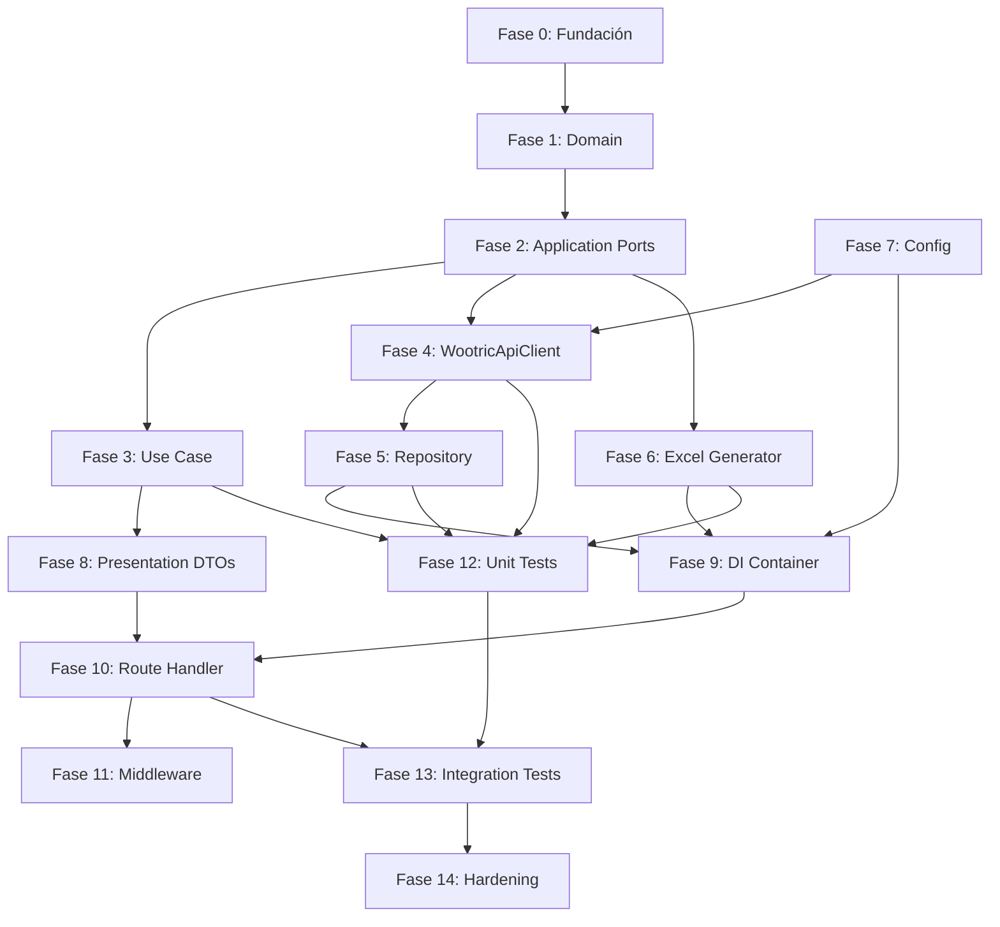

# Plan de Trabajo: Wootric SaaS Analytics — Migración a Next.js + Clean Architecture

**Arquitecto:** Senior Software Architect  
**Proyecto:** Micro SaaS Analytics  
**Stack:** Next.js App Router · TypeScript · Supabase · Clean Architecture  
**Estado:** ⏸️ Pendiente de aprobación

---

## 📐 Arquitectura General

```
src/
├── app/                    # Next.js App Router (entry points)
│   └── api/
│       └── wootric/
│           └── responses/
│               └── export/
│                   └── route.ts
│
├── application/            # Casos de uso, puertos (interfaces)
│   ├── ports/
│   │   ├── IWootricRepository.ts
│   │   └── IExcelGenerator.ts
│   └── useCases/
│       └── ExportWootricResponsesUseCase.ts
│
├── domain/                 # Entidades puras, value objects, DTOs
│   ├── entities/
│   │   ├── WootricResponse.ts
│   │   ├── EndUser.ts
│   │   └── SurveyResponseExport.ts
│   ├── valueObjects/
│   │   ├── DateRange.ts
│   │   └── WootricCredentials.ts
│   └── errors/
│       └── DomainError.ts
│
├── infrastructure/         # Adaptadores concretos
│   ├── http/
│   │   └── WootricApiClient.ts
│   ├── excel/
│   │   └── ExcelGeneratorService.ts
│   ├── repositories/
│   │   └── WootricRepository.ts
│   └── config/
│       └── env.ts
│
├── presentation/           # DTOs de request/response, serializers
│   ├── dtos/
│   │   ├── ExportWootricResponsesRequestDTO.ts
│   │   └── ExportWootricResponsesResponseDTO.ts
│   └── serializers/
│       └── ExcelResponseSerializer.ts
│
├── di/                     # Dependency Injection container
│   └── container.ts
│
└── middleware.ts           # Next.js middleware (logging, CORS, etc.)
```

---

## 🗺️ Fases del Plan

### FASE 0 — Fundación del proyecto
**Duración estimada:** 1 sesión  
**Dependencias:** Ninguna

- [ ] Inicializar proyecto Next.js 14+ con App Router + TypeScript
- [ ] Configurar `tsconfig.json` (strict mode, paths absolutos)
- [ ] Instalar dependencias: `exceljs`, `zod`, `tsyringe` o `awilix` (DI)
- [ ] Instalar dependencias de desarrollo: Jest 30, `ts-jest`, `@types/*`
- [ ] Configurar Jest (`jest.config.ts`)
- [ ] Crear estructura completa de carpetas (`src/`)
- [ ] Configurar ESLint + Prettier
- [ ] Crear `.env.example` con todas las variables requeridas
- [ ] Configurar `next.config.js` para compilar módulos

**Entregables:**
- `package.json` con scripts configurados
- `jest.config.ts` funcional
- Estructura de carpetas creada
- Proyecto compila sin errores (`npm run dev`)

**Criterio de aprobación:** `npm run dev` y `npm run build` pasan sin errores.

---

### FASE 1 — Capa de Dominio (Domain)
**Duración estimada:** 1 sesión  
**Dependencias:** Fase 0

- [ ] Definir entidad `EndUser` (clase pura, sin dependencias externas)
- [ ] Definir entidad `WootricResponse` (value objects incluidos)
- [ ] Definir entidad `SurveyResponseExport` (DTO de exportación)
- [ ] Definir Value Objects: `DateRange`, `WootricCredentials`
- [ ] Definir errores de dominio: `DomainError`, `InvalidDateRangeError`, `InvalidCredentialsError`, `AuthenticationError`, `ApiError`
- [ ] Definir tipos estrictos para los enums y constantes

**Reglas:**
- ❌ No importar nada de `infrastructure/`, `application/`, `presentation/`
- ✅ Solo TypeScript nativo
- ✅ Principio de mínima dependencia

**Entregables:**
- `src/domain/entities/*.ts`
- `src/domain/valueObjects/*.ts`
- `src/domain/errors/*.ts`

**Criterio de aprobación:** Las entidades son puras, sin imports de infraestructura.

---

### FASE 2 — Puertos de Aplicación (Application Ports)
**Duración estimada:** 1 sesión  
**Dependencias:** Fase 1

- [ ] Definir interfaz `IWootricRepository` con métodos:
  - `authenticate(credentials): Promise<AuthToken>`
  - `getResponses(params): Promise<WootricResponse[]>`
  - `getPaginatedResponses(params): AsyncGenerator<WootricResponse>`
- [ ] Definir interfaz `IExcelGenerator` con métodos:
  - `generateExport(data): Promise<Buffer>`
  - `generateHeaders(): string[]`
- [ ] Definir tipos para los parámetros de repositorio:
  - `GetResponsesParams`
  - `PaginatedResponsesParams`
  - `WootricAuthToken`
- [ ] Definir interfaz de logging `ILogger`

**Entregables:**
- `src/application/ports/IWootricRepository.ts`
- `src/application/ports/IExcelGenerator.ts`
- `src/application/ports/ILogger.ts`
- `src/application/ports/types.ts`

**Criterio de aprobación:** Interfaces completas con tipos estrictos.

---

### FASE 3 — Caso de Uso (Application Use Case)
**Duración estimada:** 1 sesión  
**Dependencias:** Fase 2

- [ ] Implementar `ExportWootricResponsesUseCase`
  - Validar fechas de entrada (uso de `DateRange` value object)
  - Obtener responses paginados vía `IWootricRepository`
  - Transformar a `SurveyResponseExport[]`
  - Generar Excel vía `IExcelGenerator`
  - Retornar buffer + metadata
- [ ] Implementar mapas de transformación: `WootricResponse → SurveyResponseExport`
- [ ] Implementar validadores de dominio
- [ ] Manejo de errores con Result Pattern (opcional) o try-catch con errores de dominio

**Entregables:**
- `src/application/useCases/ExportWootricResponsesUseCase.ts`
- `src/application/useCases/__tests__/ExportWootricResponsesUseCase.test.ts`

**Criterio de aprobación:** El caso de uso no depende de implementaciones concretas.

---

### FASE 4 — Infraestructura: Wootric API Client
**Duración estimada:** 1-2 sesiones  
**Dependencias:** Fase 2

- [ ] Implementar `WootricApiClient`:
  - Autenticación OAuth2 con caching de token en memoria
  - GET `/v1/responses` con paginación secuencial
  - Retry policy (3 intentos, exponential backoff)
  - Timeout handling (configurable, default 30s)
  - Rate limit handling (HTTP 429 con retry-after)
  - Paginación: `page`, `per_page`, deduplicación por `id`
  - Protección contra infinite loops (max pages: 500)
  - Logging de cada request, sync y error
- [ ] Implementar `WootricAuthManager`:
  - Token lifecycle management
  - Refresh automático si expira
  - Thread-safe caching

**Entregables:**
- `src/infrastructure/http/WootricApiClient.ts`
- `src/infrastructure/http/WootricAuthManager.ts`
- `src/infrastructure/http/__tests__/WootricApiClient.test.ts`

**Criterio de aprobación:** Pruebas con mocks HTTP pasan.

---

### FASE 5 — Infraestructura: Repositorio
**Duración estimada:** 1 sesión  
**Dependencias:** Fase 4

- [ ] Implementar `WootricRepository` implementando `IWootricRepository`
  - Adapta `WootricApiClient` a las interfaces de dominio
  - Normaliza datos crudos → `WootricResponse` entities
  - Manejo de errores de infra → errores de dominio
- [ ] Mapper de response Wootric → entidad `WootricResponse`

**Entregables:**
- `src/infrastructure/repositories/WootricRepository.ts`
- `src/infrastructure/repositories/__tests__/WootricRepository.test.ts`

**Criterio de aprobación:** Repositorio mapea correctamente datos crudos a entidades.

---

### FASE 6 — Infraestructura: Excel Generator
**Duración estimada:** 1 sesión  
**Dependencias:** Fase 2

- [ ] Implementar `ExcelGeneratorService` implementando `IExcelGenerator`:
  - Usar `exceljs` (no openpyxl)
  - Headers: response_id, end_user_id, survey_id, score, feedback, completed, excluded_from_calculations, created_at, updated_at, email, external_id, end_user_created_at, survey_channel
  - Auto-fit column widths
  - Header styles: bold, background color (#1F2937), white font
  - Freeze header row
  - Auto-filter enabled
  - Data types correctos (number, string, date)
- [ ] Manejo de edge cases: datos vacíos, valores null

**Entregables:**
- `src/infrastructure/excel/ExcelGeneratorService.ts`
- `src/infrastructure/excel/__tests__/ExcelGeneratorService.test.ts`

**Criterio de aprobación:** Genera Excel válido con todas las columnas y estilos.

---

### FASE 7 — Infraestructura: Configuración
**Duración estimada:** 0.5 sesión  
**Dependencias:** Fase 0

- [ ] Implementar `env.ts` con Zod validation
  - WOOTRIC_API_URL
  - WOOTRIC_USERNAME
  - WOOTRIC_PASSWORD
  - Valores por defecto y validación en runtime

**Entregables:**
- `src/infrastructure/config/env.ts`
- `src/infrastructure/config/__tests__/env.test.ts`

**Criterio de aprobación:** Variables validadas correctamente en startup.

---

### FASE 8 — Presentation: DTOs y Serializers
**Duración estimada:** 0.5 sesión  
**Dependencias:** Fase 1

- [ ] Implementar `ExportWootricResponsesRequestDTO` con Zod:
  - startDate: string (ISO date, opcional)
  - endDate: string (ISO date, opcional)
- [ ] Implementar `ExportWootricResponsesResponseDTO`:
  - Indica streaming de archivo
- [ ] Implementar `ExcelResponseSerializer`:
  - Setea Content-Type, Content-Disposition
  - Retorna `NextResponse` con buffer

**Entregables:**
- `src/presentation/dtos/*.ts`
- `src/presentation/serializers/*.ts`

**Criterio de aprobación:** DTOs validan correctamente inputs.

---

### FASE 9 — Dependency Injection
**Duración estimada:** 0.5 sesión  
**Dependencias:** Fases 1-8

- [ ] Implementar contenedor DI en `src/di/container.ts`
  - Opción A: `tsyringe` (decorators)
  - Opción B: `awilix` (auto-register)
  - Opción C: manual factory (sin librería externa)
- [ ] Registrar:
  - `WootricApiClient` (singleton)
  - `WootricAuthManager` (singleton)
  - `WootricRepository` (transient)
  - `ExcelGeneratorService` (transient)
  - `ExportWootricResponsesUseCase` (transient)
  - Logger implementation

**Entregables:**
- `src/di/container.ts`

**Criterio de aprobación:** Contenedor resuelve todas las dependencias.

---

### FASE 10 — Route Handler (Presentation)
**Duración estimada:** 0.5 sesión  
**Dependencias:** Fase 9

- [ ] Implementar `GET /api/wootric/responses/export/route.ts`
  - Validar query params con DTO de presentación
  - Resolver `ExportWootricResponsesUseCase` del contenedor DI
  - Ejecutar caso de uso
  - Serializar respuesta con `ExcelResponseSerializer`
  - Manejo de errores: capturar `DomainError` y retornar HTTP errors semánticos
  - Logging de request/response

**Entregables:**
- `src/app/api/wootric/responses/export/route.ts`

**Criterio de aprobación:** Endpoint funcional respondiendo con archivo Excel.

---

### FASE 11 — Middleware
**Duración estimada:** 0.5 sesión  
**Dependencias:** Fase 10

- [ ] Implementar `middleware.ts`:
  - Logging de requests (method, path, duration)
  - Manejo de CORS headers
  - Rate limiting básico (opcional)

**Entregables:**
- `src/middleware.ts`

**Criterio de aprobación:** Middleware se ejecuta en cada request.

---

### FASE 12 — Testing: Unit Tests
**Duración estimada:** 1 sesión  
**Dependencias:** Fases 1-7

- [ ] Escribir tests unitarios para:
  - `DomainError` y subtipos
  - `DateRange` value object (validación, parsing)
  - `ExportWootricResponsesUseCase` (con mocks de puertos)
  - Mappers y transformaciones
- [ ] Mocks manuales o con `jest.mock()`

**Entregables:**
- Tests en cada carpeta `__tests__/`

**Criterio de aprobación:** Coverage mínimo 80% en domain + application.

---

### FASE 13 — Testing: Integration Tests
**Duración estimada:** 1 sesión  
**Dependencias:** Fase 12

- [ ] Escribir tests de integración:
  - `WootricApiClient` con servidor mock (MSW o similar)
  - `WootricRepository` con ApiClient mockeado
  - `ExcelGeneratorService` con datos reales
  - End-to-end: route handler → caso de uso → Excel generado
- [ ] Configurar MSW (Mock Service Worker) para tests de red

**Entregables:**
- `src/__tests__/integration/` tests

**Criterio de aprobación:** End-to-end test genera Excel válido.

---

### FASE 14 — Revisión y Hardening
**Duración estimada:** 1 sesión  
**Dependencias:** Fases 0-13

- [ ] Revisión de seguridad:
  - ¿Hay hardcodeo de credenciales? ❌ No
  - ¿Hay logging de secretos? ❌ No
  - ¿Timeout en todas las llamadas HTTP? ✅
  - ¿Rate limiting implementado? ✅
- [ ] Revisión de performance:
  - ¿Streaming de datos? ✅
  - ¿Paginación eficiente? ✅
  - ¿Memory safety? ✅
- [ ] Revisión de código:
  - ¿Sigue SOLID? ✅
  - ¿Clean Architecture? ✅
  - ¿TypeScript strict? ✅
- [ ] Documentación:
  - `README.md` con ejemplos de uso
  - Ejemplos de request/response en `docs/`

**Entregables:**
- Código revisado y optimizado
- `docs/API.md` (o README)

**Criterio de aprobación:** Code review completo sin observaciones críticas.

---

## 📊 Dependencias entre fases



---

## ⚠️ Decisiones técnicas pendientes (requieren tu input)

| # | Decisión | Opciones | Recomendación |
|---|----------|----------|---------------|
| 1 | **Librería de DI** | `tsyringe` vs `awilix` vs manual | `tsyringe` por simplicidad y decoradores |
| 2 | **Result Pattern vs excepciones** | `Either<L, R>` vs throws | Recomiendo Result Pattern para caso de uso, excepciones para dominio |
| 3 | **Logger** | `pino` vs `winston` vs `console` | `pino` por performance en serverless |
| 4 | **Zod vs Yup para validación** | `zod` vs `yup` | `zod` por ser más TypeScript-native |
| 5 | **HTTP client** | `fetch` nativo vs `axios` | `fetch` nativo (ya disponible en Next.js, sin dependencia extra) |
| 6 | **Manejo de tokens Wootric** | En memoria vs KV Storage | En memoria para MVP, KV si se requiere multi-instancia |
| 7 | **Streaming de Excel** | `exceljs` stream vs buffer | Buffer (exceljs no soporta streaming true para archivos .xlsx completos) |
| 8 | **Formato de fecha en Excel** | ISO string vs Date serial | Fecha formateada + columna separada con timestamp Unix |

---

## 🔄 Flujo de aprobación

```
[Plan presentado]
       ↓
[Tú revisas y apruebas/rechazas/modificas]
       ↓
[Inicio Fase 0 → código generado → te presento resultados]
       ↓
[Tú apruebas Fase 0]
       ↓
[Inicio Fase 1 → ...]
       ↓
...[ciclo continuo]...
       ↓
[Fase 14 completada → proyecto finalizado]
```

Cada fase incluye:
1. **Implementación** por mi parte
2. **Presentación** de los archivos generados
3. **Tus dudas y propuestas** que surjan durante la implementación
4. **Tu aprobación explícita** para avanzar

---

## 🚀 Cómo empezamos

**Paso 1:** Revisa este plan  
**Paso 2:** Dame tu aprobación o solicita cambios  
**Paso 3:** Respondo cualquier duda técnica  
**Paso 4:** Comenzamos con **Fase 0 — Fundación**

---

*Documento generado el 2026-05-27 por Senior Software Architect*
